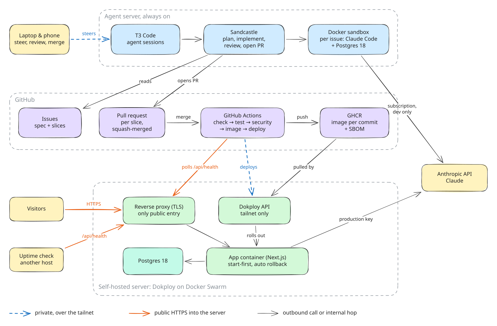

# my-notebook

## How this app is developed

This app is built mostly by AI coding agents, with a human steering the work.

- **Issues drive the work.** Specs and implementation tickets live in GitHub Issues. Tickets ready for an agent get the `ready-for-agent` label (see `docs/agents/`).
- **Sandcastle runs the build loop.** It picks the `ready-for-agent` tickets that have no open blocker, implements each one with Claude Code in a Docker sandbox, reviews it with the `code-review` skill, and opens one PR per ticket. CI checks the PR; the developer squash-merges it, which closes the ticket. Run `pnpm sandcastle`; it rebuilds the sandbox image first, since the server's Docker cleanup can delete it between runs. The config is in `.sandcastle/`.
- **T3 Code is the ADE (agentic development environment).** All agent sessions run in T3 Code.
- **A remote T3 Code server does most of the work.** It runs 24/7, so agents keep working on tickets while the laptop is closed. The laptop and phone only connect to it to steer, review, and approve.

## Credits and inspiration

- **Skills and software factory by Matt Pocock.** Most of the agent skills in `.agents/skills/` (grilling, wayfinder, tdd, code-review and more) come from [mattpocock/skills](https://github.com/mattpocock/skills), and the build loop runs on his [Sandcastle](https://github.com/mattpocock/sandcastle).
- **Inspired by** [Matt Pocock](https://www.youtube.com/@mattpocockuk), [Theo](https://www.youtube.com/@t3dotgg) (T3 Code) and [Web Dev Cody](https://www.youtube.com/@WebDevCody). Their videos on working with AI coding agents shaped how this project is built.

## Infrastructure

Every merge to `main` is tested, scanned, built into an image and deployed to Dokploy on a self-hosted server over a private tailnet; an unhealthy release rolls back on its own. [docs/infrastructure.md](docs/infrastructure.md) has the system map, the deploy and rollback flow, and where each secret lives.

[](docs/infrastructure.md)

## Local development

Requires Node 24, pnpm (via corepack) and Docker.

```sh
cp .env.example .env
docker compose up -d          # Postgres 18 with the dev and _test databases
pnpm install
pnpm db:migrate               # apply the committed SQL migrations
pnpm dev
```

| Script | What it does |
| --- | --- |
| `pnpm typecheck` | TypeScript 7 (`tsc`) over the app and `.sandcastle` |
| `pnpm lint` / `pnpm format:check` | ESLint (incl. module boundaries) and Prettier |
| `pnpm test` | Vitest unit tests and integration tests against `TEST_DATABASE_URL` |
| `pnpm test:e2e` | Playwright against a production build on the `_test` database |
| `pnpm db:generate` | Generate a migration from the modules' `schema.ts` files |
| `pnpm demo:seed` | Seed a demo Notebook into the local database (see `demo/README.md`) |
| `pnpm evals` | Run the AI evals from `demo/evals.json` (see [AI evals](#ai-evals)) |

`GET /api/health` reports the database ping, version and running commit.

## AI evals

The evals ask the questions in [`demo/evals.json`](demo/evals.json) through the real Chat and
Agent paths and check every answer: each Citation points to an existing Passage of an enabled
Source, the expected Sources are cited, the answer states the key facts, and Claude declines the
question the Sources don't cover. A Briefing is generated and checked too. They call the real API,
so they never run on PRs: run them locally or start the **Evals** workflow by hand (Actions →
Evals → Run workflow), which uses the key in the `evals` environment and writes the summary table
and cost to the job summary.

To run them locally (a full run costs under $0.50, most of it the Agent run, capped at $0.30):

```sh
pnpm db:migrate
LLM_MODE=real ANTHROPIC_API_KEY=<EVAL_KEY> pnpm evals
```

| Option | What it does |
| --- | --- |
| `--only <id>,<id>` | Ask only these questions (ids from `demo/evals.json`) |
| `--no-briefing` | Skip the Briefing |
| `--budget <usd>` | Spend cap for the run (default 2, at most 5) |

The run creates its own Visitor and Notebook in the local database (it refuses production and
non-local databases) and loads the demo Sources like a Visitor would: the pasted text and the PDF
from `demo/sources/` and the Wikipedia page fetched live. The run's
Visitor gets the budget as its Daily allowance, so the Budget guard stops a runaway run. It prints
a table with each question's checks, the Sources its answer cited, the Sources the Agent added and
its cost, and exits non-zero if any check failed. Without
`LLM_MODE=real` it runs against the scripted fake, which is useful as a free dry run, but key
facts and the uncovered question fail there.
