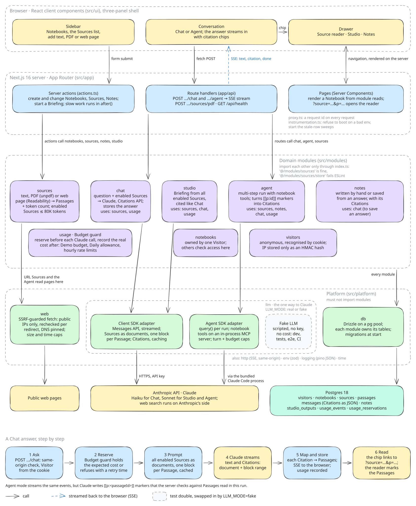

# Architecture

What runs inside the app: the browser, the Next.js server, the domain modules, the platform code under them, and the services they talk to. How the app is built and deployed is in [infrastructure.md](infrastructure.md).

Solid arrows are calls, the dashed blue arrow is the SSE stream back to the browser, and the dashed grey box is the test double. To change the drawing, open [`architecture.excalidraw`](architecture.excalidraw) in [Excalidraw](https://excalidraw.com) and export it again as SVG with "Embed scene" off and the background on.

## Walkthrough

**Browser.** One three-panel shell ([`src/ui/shell`](../src/ui/shell)): the sidebar with Notebooks and the Sources list, the conversation in the middle, and a drawer with the Source reader, Studio and Notes. Changes such as adding a Source or a Note are form submits to server actions. A Chat question or an Agent task is a `fetch` POST whose answer streams back as server-sent events ([`src/ui/chat`](../src/ui/chat)). A citation chip is a plain link to `?source=<id>&p=<ordinals>`, so opening a Passage is a navigation the server renders.

**Next.js server.** [`src/app`](../src/app) is thin. [`actions.ts`](../src/app/actions.ts) holds the server actions and hands slow work (processing a Source, writing a Briefing) to `after()`. The route handlers under [`src/app/api`](../src/app/api) stream Chat and Agent answers as SSE, take PDF uploads and serve `/api/health`. Pages are Server Components that read from the modules. Every mutation first resolves the Visitor from its cookie, and the POST routes check that the request is same-origin. [`proxy.ts`](../src/proxy.ts) gives every request an id for the logs, and [`instrumentation.ts`](../src/instrumentation.ts) refuses to boot on an invalid environment and starts the sweeps that fail rows left half-done by a restart.

**Domain modules.** [`src/modules`](../src/modules) holds one folder per area of the [glossary](../GLOSSARY.md): `sources`, `chat`, `studio`, `agent`, `notes`, `usage`, `notebooks` and `visitors`. Each module owns its tables, and its `index.ts` is its only public surface. ESLint fails a deep import such as `@/modules/sources/store`; only a module's `schema.ts` may import another module's `schema.ts`, for foreign keys ([`eslint.config.mjs`](../eslint.config.mjs)). The "uses" line in each box lists the modules it imports. Every module checks that the Notebook belongs to the current Visitor before it reads or writes.

**Sources.** A Source is pasted text, a PDF (its text layer is read with `unpdf` and the file thrown away) or a web page (fetched, then reduced to its article with Readability and DOMPurify). Each one is split into ordered Passages, the unit a Citation points to, and its tokens are counted. A Notebook's enabled Sources must fit in 80K tokens, because every answer sends all of them to Claude instead of retrieving pieces ([ADR 0002](adr/0002-long-context-and-citations-api-instead-of-rag.md)).

**Two ways to Claude.** All model access goes through `llm()` in [`src/platform/llm`](../src/platform/llm) ([ADR 0001](adr/0001-two-sdks-client-for-chat-agent-sdk-for-agent.md)). Chat and Studio use the Anthropic Client SDK: each enabled Source becomes a custom-content document with one block per Passage, with Citations on and prompt caching. The Agent uses the Claude Agent SDK with a fresh `query()` per run. Its notebook tools (list and read Sources, read a web page, add a URL Source, create a Note) are plain functions in [`src/modules/agent`](../src/modules/agent), served to the model by an in-process MCP server, alongside web search and one Skill. Turns, spend, time, web searches, page reads, added Sources and Notes are capped per run. With `LLM_MODE=fake`, the default, a scripted fake implements the same interface, so development, unit, integration and e2e tests and CI run without a key or cost.

**Budget guard and Visitors.** [`src/modules/usage`](../src/modules/usage) runs before every Chat, Studio and Agent call. It reserves the call's expected cost under a Postgres advisory lock and refuses it when the Demo budget (per day and in total), the Visitor's Daily allowance or the hourly rate limit would be passed. Calls still running count with their holds, so parallel requests can't all slip under a cap. Afterwards the real cost goes into a usage ledger and the hold is released. Visitors ([`src/modules/visitors`](../src/modules/visitors)) are anonymous: a cookie recognises them, a Visitor is only created on their first change, and their IP is kept only as an HMAC hash to limit new Visitors per IP. Visitors not seen for 30 days are purged with their Notebooks.

**Platform.** [`src/platform`](../src/platform) is infrastructure code that must not import any module (ESLint again). Besides `llm`, it has `web`, the SSRF-guarded fetcher that every server-side URL fetch uses: http(s) only, every resolved address checked against private and reserved ranges, the connection pinned to the checked address, every redirect checked again, plus time and size caps. `db` is a shared Drizzle client on a `pg` pool. `http` (SSE encoding and parsing, same-origin check), `env` (validated with zod at boot), `logging` (pino JSON with the request id) and `time` (the Berlin day the caps reset on) fill in the rest.

**Postgres.** Nine tables in one Postgres 18 database, each owned by one module: `visitors`, `notebooks`, `sources` and `passages`, `messages` (Chat and Agent answers, with their Citations stored as JSON parts), `notes`, `studio_outputs`, and `usage_events` and `usage_reservations` for the Budget guard. Migrations run when the container starts ([infrastructure.md](infrastructure.md)).

## A Chat answer

The strip at the bottom of the diagram follows one question:

1. The browser POSTs the question to `/api/notebooks/<id>/chat`. The route checks the origin, resolves the Visitor and calls `answerQuestion` in `chat`.
2. `usage` reserves the expected cost, or the browser gets a refusal with the time it lifts.
3. `chat` builds the prompt: all enabled Sources as cached documents, one block per Passage, plus the recent history that fits.
4. Claude streams text and Citations; each Citation names a document and a range of its blocks.
5. The server maps each Citation to its Source and Passages, sends text and Citation events over SSE, stores the finished answer and records the real cost.
6. The chip in the answer links to `?source=<id>&p=<ordinals>`, and the reader opens the Source with those Passages marked.

Agent mode streams the same events. Because the Agent SDK has no Citations API, the Agent writes `[[p:<passageId>]]` markers instead; the server resolves them while the text streams, keeping only Passages the Agent actually read in this run, so both modes end up with the same Citation snapshot.
