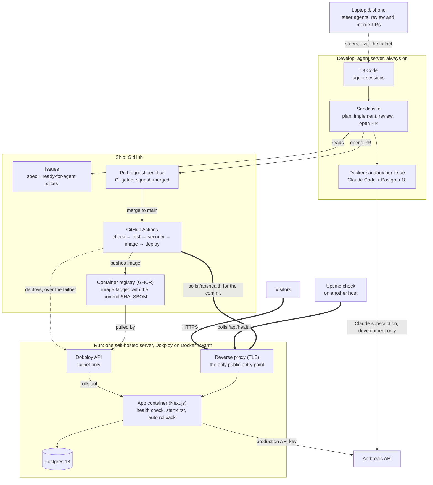
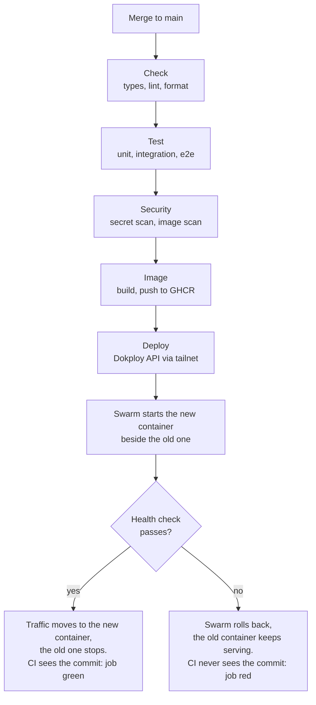

# Infrastructure

How a change travels from an issue to production, where the network boundaries sit, and what happens when a release is unhealthy. Decisions behind it: [ADR 0003](adr/0003-ci-built-image-deployed-to-dokploy-with-rollback.md).

## System map

Arrows: dotted `-.->` is private traffic over the tailnet, thick `==>` is public HTTPS into the server, plain `-->` is an outbound call or an internal hop.

- **One public door.** Visitors, the uptime check and CI's health polling all come in through the reverse proxy. Nothing else on the server answers the internet.
- **Deploys travel over the tailnet.** The deploy job joins the tailnet as a short-lived node. An access rule lets that node reach the Dokploy API and nothing else.
- **Two separate kinds of Claude access.** Agents use a subscription during development. Production uses its own API key with a spend limit and refuses to start if a subscription token is present.

## Deploy and rollback

Every merge to `main` runs the same steps. Dokploy's own Git autodeploy is off, so production runs exactly the image CI tested and scanned, and the deploy job only turns green once production reports the new commit.

Migrations run at container start under an advisory lock and are always expand/contract, so the old image keeps working on the new schema after a rollback. For a manual rollback, an older `sha-` image is retagged and redeployed; migrations are never undone.

## Where the secrets live

No key is shared between environments, and CI never holds the production LLM key. Tests run against a fake LLM.

| Secret | Stored in | Used by |
| --- | --- | --- |
| Anthropic key, production workspace (spend limit) | Dokploy app environment | The app |
| Anthropic key, dev/eval workspace (smaller spend limit) | GitHub Actions secret | The AI eval workflow, started by hand |
| Tailscale OAuth client | GitHub Actions secret | The deploy job, to join the tailnet |
| Dokploy API key and application id | GitHub Actions secret | The deploy job |
| Visitor IP hashing secret | Dokploy app environment | Rate limits per IP, without storing IPs |
| Claude subscription token | Agent server only | Coding agents during development |

## Left out on purpose

- No staging environment or preview deploys. Production follows `main`.
- Postgres backups are written up as a runbook but not switched on for this demo.
- No tracing or metrics stack. JSON logs, the health endpoint, an uptime check and a public status page cover operations.
